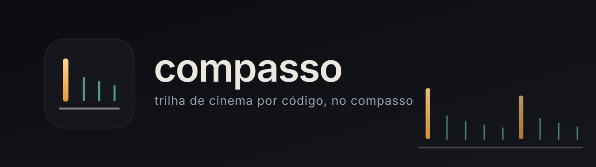

<p align="center">
  
</p>

<p align="center">
  <b>Trilha de cinema por código, no compasso.</b><br>
  Camas, percussão e golpes gerados localmente com Stable Audio 3, arranjados num grid de BPM por um motor em Python puro.<br>
  Sem nuvem, sem assinatura, e o resultado é seu.
</p>

<p align="center">
  
  
  
  
</p>

---

## Por que

Trilha de cinema não é "uma música". É **camadas num grid**: uma cama (pad, piano, drone), um pulso
feito com a percussão da própria trilha, e eventos (swells, stingers, impactos) que caem em tempos
fortes. A imagem corta nesse mesmo grid.

Modelos que geram *canções* (Suno, ACE-Step) não servem para isso: tudo vira verso e refrão.
O Compasso separa as duas coisas: **o modelo gera os sons, o código decide o tempo.**

## Como funciona

```
  Stable Audio 3 ──► camadas (wav)        cue.py ──► o arranjo no grid        ffmpeg ──► entrega
  small-music: camas tonais              eventos em segundos               loops, loudness,
  small-sfx:   stingers, risers,         align_peak: o pico cai no          espectrogramas
               impactos, texturas        tempo forte
```

| Camada | Ferramenta |
|---|---|
| Camas tonais (pad, piano, cordas, drones, até 120 s) | Stable Audio 3 **Small-Music** |
| One-shots e texturas (stinger, riser, impacto, percussão, vapor) | Stable Audio 3 **Small-SFX** |
| O arranjo (quem entra quando, no grid) | [`cue.py`](cue.py) |
| Loops sem emenda | [`make-loop.py`](make-loop.py) |
| Sons reais (um rastreador, um vapor) | amostras posicionadas pelo `cue.py` |

## Começando

### 1. Stable Audio 3, local e sem login

```bash
git clone https://github.com/Stability-AI/stable-audio-3 ~/ai/stable-audio-3 && cd ~/ai/stable-audio-3
uv venv .venv --python 3.12
uv pip install torch==2.7.1 torchaudio==2.7.1 --index-url https://download.pytorch.org/whl/cpu
uv sync --inexact --no-install-package torch --no-install-package torchaudio
uv pip install sentencepiece protobuf
```

Os pesos oficiais são *gated* no Hugging Face. O espelho `AEmotionStudio/stable-audio-3-mirrors`
tem `small-sfx/` e `small-music/` sem gate; o codificador de texto vem de `LeeAeron/t5gemma-b-b-ul2`
(copie `model.safetensors` e `tokenizer.model` para `weights/<modelo>/t5gemma-b-b-ul2/`).
Use o [`sa3_gen.py`](exemplos/sa3_gen.py) deste repo dentro da pasta do Stable Audio: ele carrega
tudo de arquivo e nunca toca no Hub. **CPU basta**: 20 s de áudio em 8 s.

### 2. Gerar camadas

```bash
cd ~/ai/stable-audio-3
.venv/bin/python sa3_gen.py --model small-music -p "calm dark ambient, slow sparse piano in A minor, 60 bpm, no drums" --duration 45 -n 2 -o pad.wav
.venv/bin/python sa3_gen.py --model small-sfx   -p "huge orchestral horror stinger, dry, short" --duration 5 -n 2 -o stinger.wav
.venv/bin/python sa3_gen.py --model small-music -p "..." --inpaint pad.wav 30 120 --duration 120 -o cont.wav   # continuação
ffmpeg -i pad.wav -ar 48000 -c:a pcm_s16le pad48.wav   # a saída é float 44,1 kHz; o cue.py lê 16-bit 48 kHz
```

### 3. Arranjar no grid

```python
import cue
cue.BPM = 60; cue.BEAT_S = 60 / cue.BPM; bar = cue.bar

EVENTS = [
    (0.0,     "layer",      dict(path="sa3/pad.wav", gain=0.8, fade=3.0)),
    (bar(2),  "score_beat", dict(bars=9, gain=1.25)),                              # taiko, metal, batimento
    (bar(5),  "layer",      dict(path="sa3/swell.wav", gain=0.9, align_peak=True)), # o pico cai no tempo forte
    (bar(5),  "layer",      dict(path="sa3/stinger.wav", gain=0.8, align_peak=True)),
    (bar(11), "layer",      dict(path="sa3/impact.wav", gain=1.0, align_peak=True)),
]
cue.render(EVENTS, length=bar(12), out="intro.wav", final_at=bar(11))  # respiro de 0,45 s antes do impacto final
```

Tipos de evento: `layer` (qualquer wav; `align_peak` põe o ponto mais alto no tempo do evento),
`sample` (wav em `SFX_DIR/<id>.wav`), `tracker` (one-shot acelerado para subir o tom), e os
sintetizados `hum`, `sub`, `ping`, `riser`, `hit`, `cluster`, `shriek`, `tick`, `drums`, `score_beat`.

## Exemplos

| Arquivo | O quê |
|---|---|
| [`exemplos/intro-alien.py`](exemplos/intro-alien.py) | a intro de Alien: Isolation do canal Lapso, 48 s, aprovada: piano em Lá menor, percussão de trilha, rastreador real subdividindo o beat, três golpes nos compassos 5, 8 e 10, impacto no 11 |
| [`exemplos/outro-alien.py`](exemplos/outro-alien.py) | a outro: cordas cruzando para piano, 30 s, sem pulso |
| [`exemplos/music-pack.sh`](exemplos/music-pack.sh) | um pack de fundo para um vídeo de 1h30: 13 climas, camas de 2 min em loop, stingers, risers, transições |
| [`exemplos/guia-de-edicao.md`](exemplos/guia-de-edicao.md) | como usar o pack numa edição: uma cama por cena, ducking, silêncio antes do susto, stinger no corte |

## Regras que aprendemos

- **O beat é o grid.** Beat jogado por cima dos efeitos não funciona; cada evento cai num tempo.
- **Percussão da trilha, não drum machine.** Taiko, metal, batimento. Nunca bumbo e caixa de lo-fi.
- **Um tom e uma família de som por projeto**, já no prompt de cada camada.
- **Terror é silêncio e espaço.** Um stinger no corte vale mais que dez em camada. Gritos em camada: não.
- **Sons reais ganham.** O rastreador do jogo, não um bip sintetizado. Mas áudio do jogo é referência,
  não entra no vídeo (direitos), salvo SFX pequeno e aprovado.
- **"Mais cinematográfico"** = swells orquestrais entrando nos golpes, sala grande, menos stab seco.
- **Ninguém ouve o render aqui.** Confira por espectrograma e loudness, descreva cada candidata e
  deixe quem decide escolher.

## Marca

Kit em [`brand/`](brand/README.md): marca, logotipo, banner, cores e voz.

## Licença

Código: MIT. Áudio gerado com Stable Audio 3: [Stability AI Community License](https://stability.ai/license)
(livre até 1 milhão de dólares de receita anual).
